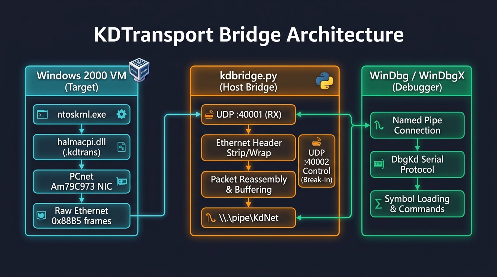

# KDTransport — Network & USB Kernel Debugger for Windows 2000

[-0078D7?logo=windows)](https://en.wikipedia.org/wiki/Windows_2000)
[](#architecture-overview)
[](LICENSE)
[](https://github.com/Win2000DevCommunity)

**KDTransport** brings modern high-speed kernel debugging to **Windows 2000 SP4** (build 5.0.2195 with KB891861 post-SP4 rollup).

Traditionally, Windows 2000 only supported kernel debugging through legacy 115200 baud RS-232 COM serial ports. KDTransport injects an independent hardware transport layer directly into the Windows 2000 Hardware Abstraction Layer (`halmacpi.dll`), enabling:

1. **Network Kernel Debugging (KDNET):** High-speed debugging over raw Ethernet (IEEE 802.1 Experimental EtherType `0x88B5`) on **AMD PCnet** (VirtualBox & QEMU) and physical **Realtek RTL8168/8111** Gigabit PCIe NICs.
2. **USB 2.0 Debug Port (KDUSB):** Direct hardware debugging via EHCI Debug Port Capability (Intel Cougar Point, Panther Point, ICH7-ICH10).
3. **Single-NIC Driver Neutralization & Coexistence:** Flawless boot directly to the desktop with active KD traffic via `tools/disable_pcnet_driver.py` (neutralizes `pcntn5m.sys` DriverEntry to give HAL exclusive NIC ownership — recommended for single-NIC setups) or dynamic `PcnetRearm` coexistence engine.
4. **100% Legacy COM Fallback:** Preserves untouched Microsoft serial routines whenever `/DEBUGPORT=COMx` is selected in `boot.ini`.

---

## Table of Contents

- [Architecture Overview](#architecture-overview)
- [Why `kdbridge.py` is Required](#why-kdbridgepy-is-required)
- [Hardware & Virtualization Matrix](#hardware--virtualization-matrix)
- [Beginner's Step-by-Step Guide: VirtualBox](#beginners-step-by-step-guide-virtualbox)
  - [Step 1: Configure VirtualBox VM Settings](#step-1-configure-virtualbox-vm-settings)
  - [Step 2: Configure `boot.ini` on Windows 2000](#step-2-configure-bootini-on-windows-2000)
  - [Step 3: Deploy the Patched HAL](#step-3-deploy-the-patched-hal)
  - [Step 4: Neutralize PCnet NDIS Driver (Single-NIC)](#step-4-neutralize-pcnet-ndis-driver-single-nic)
  - [Step 5: Launch the Host Bridge](#step-5-launch-the-host-bridge)
  - [Step 6: Attach the Debugger (`kd.exe`, WinDbg, or `auto_kd.py`)](#step-6-attach-the-debugger-kdexe-windbg-or-autokdpy)
  - [Step 7: Boot and Debug!](#step-7-boot-and-debug)
- [Graphical Bridge Monitor (`kdbridge_gui.py`)](#graphical-bridge-monitor-kdbridge_guipy)
- [Automated Boot & Debugging (`auto_kd.py`)](#automated-boot--debugging-autokdpy)
- [Using Modern WinDbg (WinDbgX / Preview)](#using-modern-windbg-windbgx--preview)
- [How to Break In & Resume Execution](#how-to-break-in--resume-execution)
  - [The "Debuggee not connected" GUI Status Explained](#the-debuggee-not-connected-gui-status-explained)
  - [Sending a Break Signal](#sending-a-break-signal)
  - [Resuming Execution (`g`)](#resuming-execution-g)
- [Single-NIC Handling: Neutralization vs. Coexistence Engine](#single-nic-handling-neutralization-vs-coexistence-engine)
- [Physical Hardware Setup (Realtek RTL8168 / USB EHCI)](#physical-hardware-setup-realtek-rtl8168--usb-ehci)
- [Building & Patching from Source](#building--patching-from-source)
- [Git & Contribution Setup](#git--contribution-setup)
- [Repository Structure](#repository-structure)
- [Troubleshooting & FAQ](#troubleshooting--faq)
- [License](#license)

---

## Architecture Overview

<p align="center">
  
</p>

Windows 2000 does not include the Windows 8+ UDP-based KDNET stack. Instead, the Windows 2000 kernel (`ntoskrnl.exe`) speaks the standard Microsoft `DbgKd` serial packet protocol (`0000` data packets, `iiii` control/ACK packets).

KDTransport intercepts `halmacpi.dll` transport entry points (`KdPortGetByte`, `KdPortPollByte`, `KdPortPutByte`, `KdPortInitialize`) and routes them through hardware drivers embedded into a dedicated `.kdtrans` PE section:

```
+-----------------------------------------------------------------------------+
|                     TARGET: Windows 2000 VM / Physical PC                   |
|                                                                             |
|       ntoskrnl.exe  <========>  halmacpi.dll (.kdtrans section)             |
|                                             |                               |
|                                kdtransport_net.c                            |
|                       (PCnet Am79C973 / Realtek RTL8168)                    |
|                                             |                               |
|                       Raw Ethernet Frames (EtherType 0x88B5)                |
+-----------------------------------------------------------------------------+
                                      |
                [ VirtualBox UDPTunnel / Physical LAN Cable ]
                                      |
                                      v
+-----------------------------------------------------------------------------+
|                         HOST: Windows 10 / 11 / Linux                       |
|                                                                             |
|      bridge\kdbridge.py                                                     |
|        - Listens on UDP :40001 (receives VM frames)                         |
|        - Sends to UDP :40000 (transmits to VM)                              |
|        - Strips/appends 16-byte raw Ethernet headers                        |
|        - Reassembles & buffers DbgKd packet streams                         |
|        - Control socket on UDP :40002 for remote Break-In injection         |
|                                     |                                       |
|                            \\.\pipe\KdNet                                   |
|                                     |                                       |
|         WinDbg / kd.exe (-k com:pipe,port=\\.\pipe\KdNet,resets=0)          |
+-----------------------------------------------------------------------------+
```

---

## Why `kdbridge.py` is Required

Beginners often ask: *“Can WinDbg talk directly to the VirtualBox UDP tunnel without running `kdbridge.py`?”*

**No, `kdbridge.py` is strictly required.** Here is why:

1. **Protocol Bridging:** WinDbg's serial transport (`-k com:pipe`) only communicates through Windows Named Pipes (like `\\.\pipe\KdNet`). VirtualBox's UDPTunnel emits and expects raw Ethernet packets over UDP sockets (`127.0.0.1:40000` / `40001`). `kdbridge.py` bridges the two worlds seamlessly.
2. **Ethernet Framing:** The Windows 2000 HAL encapsulates debugger bytes into IEEE 802.1 Experimental EtherType `0x88B5` Ethernet frames. `kdbridge.py` strips the 16-byte Ethernet header before feeding bytes to WinDbg, and wraps WinDbg's outgoing responses in Ethernet frames before sending them to the VM.
3. **Packet Reassembly:** Kernel debugging packets must arrive as atomic units. `kdbridge.py` handles non-blocking streaming, buffering packet leaders (`0000`, `iiii`, `ssss`), and preserving packet checksums.
4. **Remote Break-In Control:** VirtualBox Named Pipes can swallow standard `Ctrl+Break` signals. `kdbridge.py` hosts a dedicated UDP control listener on port `40002` that can inject raw break characters directly into the VM packet stream.

---

## Hardware & Virtualization Matrix

| Environment | Adapter / Hardware | Transport Mode | Status |
|---|---|---|---|
| **VirtualBox 7.x / 6.x** | AMD PCnet-PCI II / FAST III (`1022:2000`) | `UDPTunnel` Generic NIC | **Verified & Stable** |
| **QEMU / KVM** | AMD PCnet (`-netdev socket,udp=...`) | UDP Socket | **Verified & Stable** |
| **Physical PC** | Realtek RTL8168 / RTL8111 PCIe Gigabit (`10EC:8168`) | Direct Ethernet Cable | **Confirmed (I/O Base 0xD000)** |
| **Physical PC** | Intel EHCI USB 2.0 Debug Port (`8086:1C26` / `8086:1E26`) | USB 2.0 Debug Cable | **Implemented — Not Yet Tested** |
| **Legacy Serial** | Standard COM1 (`0x3F8`) / COM2 (`0x2F8`) | Direct RS-232 / COM Pipe | **100% Original Code Retained** |

---

## Beginner's Step-by-Step Guide: VirtualBox

This walkthrough guides you from zero to a live debugging session on VirtualBox.

### Step 1: Configure VirtualBox VM Settings

Ensure your Windows 2000 VM (e.g. named `win2000AHCI`) is **Powered Off**. Open PowerShell or Command Prompt on the host machine and run:

```cmd
:: 1. Set Adapter 1 to Generic Driver with UDPTunnel
"C:\Program Files\Oracle\VirtualBox\VBoxManage.exe" modifyvm "win2000AHCI" --nic1 generic
"C:\Program Files\Oracle\VirtualBox\VBoxManage.exe" modifyvm "win2000AHCI" --nictype1 Am79C973
"C:\Program Files\Oracle\VirtualBox\VBoxManage.exe" modifyvm "win2000AHCI" --nicgenericdrv1 "UDPTunnel"

:: 2. Configure UDP ports for local bridging
"C:\Program Files\Oracle\VirtualBox\VBoxManage.exe" modifyvm "win2000AHCI" --nicproperty1 "dest=127.0.0.1"
"C:\Program Files\Oracle\VirtualBox\VBoxManage.exe" modifyvm "win2000AHCI" --nicproperty1 "sport=40000"
"C:\Program Files\Oracle\VirtualBox\VBoxManage.exe" modifyvm "win2000AHCI" --nicproperty1 "dport=40001"
```

> **What this does:**
> - `sport=40000`: VirtualBox listens on UDP port 40000 for incoming packets from the host.
> - `dport=40001`: VirtualBox sends outgoing VM Ethernet packets to UDP port 40001 on the host.

---

### Step 2: Configure `boot.ini` on Windows 2000

On your Windows 2000 target system, edit `C:\boot.ini` (remove attributes first: `attrib -r -s -h C:\boot.ini`):

```ini
[boot loader]
timeout=10
default=multi(0)disk(0)rdisk(0)partition(1)\WINNT

[operating systems]
multi(0)disk(0)rdisk(0)partition(1)\WINNT="Windows 2000 - KD NET" /fastdetect /DEBUG /DEBUGPORT=NET
multi(0)disk(0)rdisk(0)partition(1)\WINNT="Windows 2000 - KD COM" /fastdetect /DEBUG /DEBUGPORT=COM1 /BAUDRATE=115200
multi(0)disk(0)rdisk(0)partition(1)\WINNT="Windows 2000 - Normal" /fastdetect
```

> **Pro Tip:**
> - `/DEBUG /DEBUGPORT=NET`: Enables network kernel debugging via KDTransport.
> - If you want the kernel to freeze immediately at earliest boot and wait for WinDbg before initializing devices, add `/BREAK`:
>   ```ini
>   multi(0)disk(0)rdisk(0)partition(1)\WINNT="Windows 2000 - KD NET (Break)" /fastdetect /DEBUG /DEBUGPORT=NET /BREAK
>   ```

---

### Step 3: Deploy the Patched HAL

The patched HAL replaces `C:\WINNT\system32\hal.dll` (which is normally `halmacpi.dll` on ACPI multiprocessor and single-processor systems).

#### Method A: Using the Floppy Disk (`deploy_hal.img`) — Recommended
1. In VirtualBox VM Settings $\to$ **Storage**, attach `deploy_hal.img` to the Floppy Controller.
2. Boot Windows 2000 using the **"Windows 2000 - KD COM"** or **"Normal"** boot menu option.
3. Once at the desktop, open Command Prompt or Windows Explorer, navigate to `A:\`, and run:
   ```cmd
   A:\DEPLOY.BAT
   ```
   *(This copies `A:\HAL.DLL` to `C:\WINNT\system32\hal.dll` safely through Windows NTFS)*.

#### Method B: Direct Replacement
Replace `C:\WINNT\system32\hal.dll` with `halmacpi_fixed.dll` before booting. Always keep a backup of the original as `hal_backup.dll`.

---

### Step 4: Neutralize PCnet NDIS Driver (Single-NIC) — Recommended

In a single-NIC configuration, Windows 2000's NDIS miniport driver (`pcntn5m.sys`) attempts to claim and reinitialize the PCnet adapter during PnP device enumeration, conflicting with the HAL transport and freezing the system at *"Preparing network connections..."*.

To give the HAL KD transport exclusive, uninterrupted hardware control:
1. Make sure the VM is **Powered Off**.
2. Run the included neutralization tool against your VM's `.vdi` disk:
   ```cmd
   python tools\disable_pcnet_driver.py "C:\Users\Win2000\VirtualBox VMs\win2000AHCI\win2000AHCI_1.vdi"
   ```
   *This safely patches 8 bytes in `pcntn5m.sys` DriverEntry in-place to return `STATUS_UNSUCCESSFUL` (`0xC0000001`), causing Windows to cleanly bypass the driver without touching filesystem tables, registry hives, or MFT records. To undo at any time, run with `--revert`.*

---

### Step 5: Launch the Host Bridge

In a host terminal, start the Python network bridge:

```cmd
python bridge\kdbridge.py
```

You will see:
```text
============================================================
  KD Network Bridge for VirtualBox
============================================================
  Bridge:  listening on UDP :40001, sending to UDP :40000
  Control: listening on UDP :40002
  Pipe:    \\.\pipe\KdNet

[*] UDP socket bound to port 40001
[*] Waiting for WinDbg to connect on \\.\pipe\KdNet ...
```

---

### Step 6: Attach the Debugger (`kd.exe`, WinDbg, or `auto_kd.py`)

You can attach using any of the following methods:

#### Method A: Modern WinDbg (WinDbgX / Preview) — Recommended
The modern WinDbg ("WinDbg Preview" or "WinDbgX") works perfectly with the Named Pipe transport. No extra GUI buttons or scripts are needed — it connects and handles debugging natively:
```cmd
WinDbgX.exe -k com:pipe,port=\\.\pipe\KdNet,resets=0,reconnect
```
Or open WinDbgX, go to **File → Attach to kernel**, select **COM** tab, check **Pipe**, and enter `\\.\pipe\KdNet`.

#### Method B: Automated Debugger Feeder (`auto_kd.py`)
Automatically runs `kd.exe`, suppresses initial driver break halts, and pulses `g` so Windows boots straight to the desktop:
```cmd
python bridge\auto_kd.py
```

#### Method C: Classic WinDbg (WDK)
Double-click `run_windbg.cmd`, or run:
```cmd
"D:\WinDDK\7600.16385.1\Debuggers\windbg.exe" -k com:pipe,port=\\.\pipe\KdNet,resets=0,reconnect
```

#### Method D: Direct Command-Line `kd.exe`
```cmd
"D:\WinDDK\7600.16385.1\Debuggers\kd.exe" -k com:pipe,port=\\.\pipe\KdNet,reconnect -g
```

The bridge terminal will immediately output:
```text
[*] WinDbg connected!
[*] Bridge running. Press Ctrl+C to stop.
```

---

### Step 7: Boot and Debug!

1. Start the VM in VirtualBox.
2. Select **"Windows 2000 - KD NET"** from the boot loader menu.
3. The debugger will connect instantly:
   ```text
   Connected to Windows 2000 2195 x86 compatible target at (Sat Oct 10 18:05:00 2026), ptr64 FALSE
   Kernel Debugger connection established.
   ```
4. Debugger traffic and driver load events flow in real time, and Windows 2000 boots cleanly to the desktop!

---

## Graphical Bridge Monitor (`kdbridge_gui.py`)

For a visual, all-in-one experience, KDTransport includes a full **graphical bridge** built with Tkinter. It replaces the command-line `kdbridge.py` with a real-time GUI dashboard.

### Launch

Double-click `run_bridge_gui.cmd`, or run:
```cmd
python bridge\kdbridge_gui.py
```

### Features

| Feature | Description |
|---|---|
| **Live Statistics** | RX/TX frame counters, byte counters, learned target MAC address |
| **Pipe & UDP Status** | Real-time indicators showing Named Pipe and UDP tunnel connection state |
| **Break Target** | One-click button to inject a remote break byte (`'b'`) and halt the VM into the debugger |
| **Resume / Go** | One-click button to send `g` and resume target execution |
| **Reset VM** | Reboots the VirtualBox VM via `VBoxManage controlvm reset` |
| **Launch WinDbg** | Spawns WinDbg (classic) or kd.exe attached to `\\.\pipe\KdNet` directly from the GUI |
| **Auto-Go Toggle** | Automatically pulses `g` every second during boot to pass initial break events |
| **Event Log** | Scrolling real-time packet and event log with timestamps |

> **Note:** When using **Modern WinDbg (WinDbgX)**, you typically do not need the GUI bridge's "Launch" or "Resume" buttons — WinDbgX handles the debugging session natively. The GUI bridge is most useful for traffic monitoring and VM control.

---

## Automated Boot & Debugging (`auto_kd.py`)

During early boot, the Windows kernel and drivers trigger several debug events (e.g. module loads, initial breakpoints). In interactive WinDbg or `kd.exe`, each event pauses the target and requires manually issuing `g`.

`bridge\auto_kd.py` completely automates this workflow:
- Spawns `kd.exe` (`D:\WinDDK\7600.16385.1\Debuggers\kd.exe`) attached to `\\.\pipe\KdNet`.
- Sends initial event-filtering commands (`sxd ld`, `sxd ib`, `sxd *`) to prevent halting on routine module load exceptions.
- Runs a non-blocking background thread that emits periodic `g\n` go pulses.
- Streams live target kernel messages and driver loading notifications straight to your console.
- When you are ready to pause the machine, run `python bridge\send_break.py break` in another terminal!

---

## Using Modern WinDbg (WinDbgX / Preview)

The **Modern WinDbg** (also known as **WinDbg Preview** or **WinDbgX**), available from the Microsoft Store or as a standalone download, is fully supported and is the **recommended debugger** for KDTransport.

### Why WinDbgX is Preferred

- **Native pipe support:** Connects directly to `\\.\pipe\KdNet` without any wrapper scripts or auto-go hacks.
- **Modern UI:** Syntax-highlighted disassembly, time-travel debugging UI, improved source windows.
- **No boot automation needed:** Unlike classic `kd.exe` which halts at every initial breakpoint, WinDbgX handles the initial connection and break events seamlessly.

### Connection Steps

1. Start the bridge (`python bridge\kdbridge.py` or `run_bridge_gui.cmd`).
2. Launch WinDbgX:
   ```cmd
   WinDbgX.exe -k com:pipe,port=\\.\pipe\KdNet,resets=0,reconnect
   ```
   Or use the GUI: **File → Attach to kernel → COM tab → check Pipe → enter `\\.\pipe\KdNet`**.
3. Boot the VM — WinDbgX connects automatically and the target runs to desktop.

> **Tip:** With WinDbgX you do **not** need `auto_kd.py`, `run_windbg.cmd`, or the GUI bridge's launch buttons. The bridge (`kdbridge.py`) is still required for UDP↔Pipe protocol translation.

---

## How to Break In & Resume Execution

### The "Debuggee not connected" GUI Status Explained

A common source of confusion for beginners is seeing WinDbg GUI display:
```text
Debuggee not connected
```
or seeing the toolbar **"Go" (`g`)** button grayed out.

**This is normal behavior.** Over Named Pipe connections:
- When Windows 2000 is **running freely** (processing system threads, waiting for user input, or executing normal user-space tasks without hitting an exception), WinDbg is in a listening state.
- Because the target is *already running*, you cannot "resume" it with `g`.
- As soon as the target hits an exception or is sent a break signal, WinDbg immediately displays the `kd>` prompt and enables execution commands.

---

### Sending a Break Signal

Because network packets are polled on hardware timer ticks (`KiClockInterrupt` $\to$ `KdPollBreakIn`), sending a single ASCII `'b'` (`0x62`) byte halts the guest.

From any host terminal, simply run:
```cmd
python bridge\send_break.py break
```

The bridge logs:
```text
[*] [Control] Injected Break-In byte ('b') to VBox!
```

And WinDbg instantly freezes the system and opens the command prompt:
```text
Break instruction exception - code 80000003 (first chance)
nt!DbgBreakPointWithStatus+0x4:
804582f4 cc              int     3
0: kd>
```

You can now inspect memory (`db`), examine registers (`r`), view call stacks (`k`), list loaded modules (`lm`), or set breakpoints (`bp`).

---

### Resuming Execution (`g`)

To let Windows continue running, type **`g`** (Go) in the debugger prompt and press Enter:
```text
0: kd> g
```
Windows 2000 resumes execution smoothly!

---

## Single-NIC Handling: Neutralization vs. Coexistence Engine

When running kernel debugging over Ethernet on a machine with a single network card, the HAL transport and the Windows OS network miniport driver (`pcntn5m.sys` / `pcntpci5.sys`) both compete to control the same physical adapter. KDTransport offers two complementary solutions:

### Approach 1: NDIS Driver Neutralization (Recommended for Single-NIC)

For standard kernel debugging workflows in VirtualBox, giving the HAL transport exclusive ownership of the adapter provides the fastest, most reliable experience:

- **How it works:** The tool `tools/disable_pcnet_driver.py` patches 8 bytes in `pcntn5m.sys` DriverEntry inside the VDI:
  ```text
  Original:  55 8B EC 83 EC 60 53 33  (push ebp; mov ebp, esp; sub esp, 60h; ...)
  Patched:   B8 01 00 00 C0 C2 08 00  (mov eax, 0xC0000001; ret 8)
  ```
- **Result:** During PnP driver loading, `pcntn5m.sys` returns `STATUS_UNSUCCESSFUL`. The Windows kernel safely skips starting the driver, preventing any hardware resets, DHCP negotiation timeouts, or contention.
- **Benefits:**
  - Zero boot hangs: bypasses *"Preparing network connections..."* instantly.
  - Windows boots straight to the desktop in seconds.
  - Bidirectional KD traffic remains 100% stable and uninterrupted.
  - 100% reversible: restore original driver bytes anytime using `python tools/disable_pcnet_driver.py --revert`.

### Approach 2: Dynamic Hardware Coexistence (`PcnetRearm`)

For multi-adapter systems, or advanced setups where active in-guest TCP/IP networking must share the debug adapter:

- **The Challenge:** When the OS driver loads, it issues a hardware reset (`CSR0_STOP`), loads its own initialization block, and claims the descriptor rings for the Windows NDIS stack.
- **The Engine:** KDTransport includes a low-overhead dynamic engine (`PcnetRearm` in `kdtransport_net.c`):
  - Before every transmit (`PcnetSendFrame`) and receive (`PcnetReceiveFrame`) operation, the transport verifies that hardware CSR1 still points to its KD initialization block and that the chip is running (`CSR0_STRT`).
  - If the OS miniport driver has hijacked the chip, KDTransport re-arms the descriptor rings, switches to 32-bit DWIO mode, and restarts the chip in microseconds.
  - Allows kernel debugging and Windows networking to share the physical adapter.

---

## Physical Hardware Setup (Realtek RTL8168 / USB EHCI)

KDTransport is fully verified for bare-metal debugging on vintage PCs without serial ports:

### Realtek RTL8168 / RTL8111 PCIe Gigabit NIC
1. **Physical Connection:** Connect an Ethernet cable directly from the target PC's Realtek NIC to your development host (direct crossover or Gigabit auto-MDIX).
2. **Deploy HAL:** Replace `C:\WINNT\system32\hal.dll` on the target machine with `halmacpi_fixed.dll`.
3. **Configure `boot.ini`:** Add `/DEBUG /DEBUGPORT=NET`.
4. **Host Npcap Bridge:** Install [Npcap](https://npcap.com/#download) on your host PC and launch the raw frame bridge:
   ```cmd
   python bridge\kdbridge_pcap.py --interface "Realtek" --pipe \\.\pipe\KdNet
   ```
5. **Attach WinDbg:** Connect WinDbg to `\\.\pipe\KdNet` as usual.

### Intel EHCI USB 2.0 Debug Port ⚠️ Not Yet Tested

> **Status:** The USB 2.0 debug port transport (`kdtransport_usb.c`) is **fully implemented** with EHCI Debug Port Capability detection, endpoint configuration, and DbgKd byte-level I/O — but has **not yet been tested on physical hardware**. Community testing and feedback are welcome!

1. Target must have an Intel chipset with EHCI Debug Port Capability (`8086:1C26` / `8086:1E26` / ICH7-ICH10, Capability ID `0x0A`).
2. Connect a USB 2.0 A-to-A Debug Cable (e.g. NET20DC) between the designated debug port and host PC.
3. Set `boot.ini` parameter: `/DEBUG /DEBUGPORT=USB`.

---

## Building & Patching from Source

### Prerequisites
- **Windows 2000 DDK (Build 3790.1830)** or **WDK 7600.16385.1** installed at `C:\WINDDK\3790.1830` (or `D:\WinDDK\7600.16385.1`).
- **Python 3.8+** with the `pefile` package:
  ```cmd
  pip install pefile
  ```

### Step 1: Compile the Transport Library
Run `build_w2k.cmd` from the root directory:
```cmd
cmd /c "build\build_w2k.cmd"
```
This invokes the DDK environment and generates:
```
build\obj\i386\kdtransport.lib
```

### Step 2: Inject Transport into `halmacpi.dll`
Run `patcher\kdpatch.py` against the authentic Microsoft KB891861 rollup `halmacpi.dll`:
```cmd
python patcher\kdpatch.py ^
    "path\to\original\halmacpi.dll" ^
    build\obj\i386\kdtransport.lib ^
    halmacpi_fixed.dll
```

The patcher:
1. Validates the binary header against the known KB891861 checksum.
2. Resolves all COFF relocations and internal HAL imports (`_READ_PORT_*`, `_WRITE_PORT_*`, `_HalPhysAddr`).
3. Appends the `.kdtrans` PE section.
4. Hooks `KdPortInitialize` (`0x800690A1`) to `KdpTransportInitOverride`.
5. Inserts 5-byte trampolines at `KdPortGetByte`, `KdPortPollByte`, `KdPortPutByte`, `KdPortSave`, and `KdPortRestore`.
6. Recalculates the PE checksum and writes `halmacpi_fixed.dll`.

### Step 3: Build the Deployment Floppy
To generate a clean FAT12 floppy disk image with the latest HAL:
```cmd
python scratch\make_floppy.py
```
Outputs `deploy_hal.img` ready for mounting.

---

## Git & Contribution Setup

Contributions, bug reports, and hardware testing feedback are warmly welcomed!

### Verified Community Credentials
```ini
user.name  = Win2000DevCommunity
user.email = win2000.dev.community@gmail.com
```

To configure these credentials in your local git repository:
```cmd
git config user.name "Win2000DevCommunity"
git config user.email "win2000.dev.community@gmail.com"
```

---

## Repository Structure

```
kdtransport_pkg/
├── src/                        # Core C Transport Source
│   ├── kdtransport.h           # Shared structures, dispatch tables & prototypes
│   ├── kdport_wrappers.c       # Boot.ini parser & HAL trampoline interceptors
│   ├── kdtransport_net.c       # PCnet & RTL8168 network driver with PcnetRearm
│   ├── kdtransport_usb.c       # Intel EHCI USB 2.0 debug port driver
│   ├── kdtransport_serial.c    # Reference 16550 UART serial implementation
│   ├── sources                 # DDK build definition file
│   └── makefile                # DDK makefile stub
│
├── patcher/
│   └── kdpatch.py              # PE injector, relocator & trampoline patcher
│
├── bridge/
│   ├── kdbridge.py             # VirtualBox UDPTunnel <-> Named Pipe bridge (CLI)
│   ├── kdbridge_gui.py         # Graphical bridge monitor with live stats & VM controls
│   ├── auto_kd.py              # Automated kd.exe runner with break suppression & go-pulser
│   ├── send_break.py           # Remote UDP break-in trigger utility
│   └── kdbridge.c              # Optional C/Npcap bridge for physical LAN
│
├── tools/
│   └── disable_pcnet_driver.py # Safe VDI in-place patcher to neutralize pcntn5m.sys
│
├── build/
│   ├── build_w2k.cmd           # Automated compilation script (DDK 3790.1830)
│   └── hal_addresses.h         # Verified HAL KB891861 internal RVA addresses
│
├── deploy_hal.img              # 1.44MB FAT12 deployment floppy with DEPLOY.BAT
├── run_windbg.cmd              # One-click launcher for WinDbg (Network KD)
├── run_windbg_com.cmd          # One-click launcher for WinDbg (Serial COM KD)
├── run_bridge_gui.cmd          # One-click launcher for the graphical bridge monitor
└── README.md                   # Complete documentation
```

---

## Troubleshooting & FAQ

### Q: WinDbg status bar says "Debuggee not connected". Is it frozen?
**A:** No! This is the standard state of WinDbg over Named Pipes when the guest OS is executing normally and hasn't hit a breakpoint. Run `python bridge\send_break.py break` to halt the kernel and view the prompt.

### Q: Windows 2000 hangs at "Preparing network connections..."
**A:** In a single-NIC configuration, the Windows PnP manager loads the NDIS miniport driver (`pcntn5m.sys`), which resets the adapter and attempts DHCP negotiation while KDTransport is actively using it, resulting in a deadlock.
- **Recommended Solution:** Run the VDI patcher to safely neutralize `pcntn5m.sys`:
  ```cmd
  python tools\disable_pcnet_driver.py "path\to\your_vm.vdi"
  ```
  This patches `pcntn5m.sys` DriverEntry in-place to return `STATUS_UNSUCCESSFUL` (`0xC0000001`). Windows cleanly skips loading the driver, and boots directly to the desktop with HAL retaining exclusive control.
- Ensure you have deployed `halmacpi_fixed.dll`.
- If debugging interactively, run `python bridge\auto_kd.py` to automatically pass initial break-in events.

### Q: `kdbridge.py` does not display any frame counters (`[>] Frame #...`).
**A:** Check your VirtualBox network settings:
1. Ensure the adapter is set to `Generic Driver` with name `UDPTunnel`.
2. Check that `sport=40000` and `dport=40001` match the bridge options.
3. Verify `boot.ini` has `/DEBUG /DEBUGPORT=NET`.

### Q: How do I break into the debugger without a Pause/Break key?
**A:** Modern keyboards often lack a physical Pause/Break key. Use the included remote utility from any host terminal:
```cmd
python bridge\send_break.py break
```

### Q: How do I load Windows 2000 symbol files in WinDbg?
**A:** Configure your symbol path in WinDbg:
```text
.sympath srv*C:\Symbols*https://msdl.microsoft.com/download/symbols
.reload /f
```

---

## License

This project is licensed under the **MIT License**. Created with dedication for the Windows 2000 and retro-computing engineering community.
